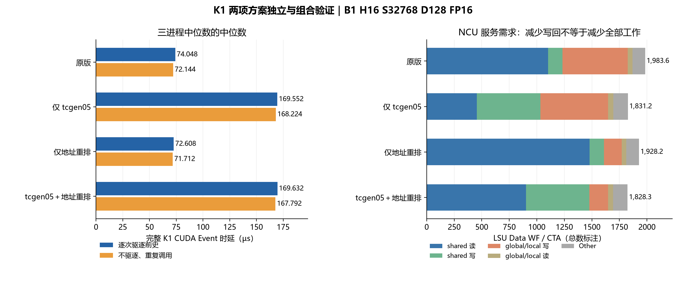

# K1 tcgen05与地址布局独立和组合验证

## 结论

原计划四组完整K1实验已完成。主配置FP16、B1/H16/S32768/D128：仅地址重排使逐次驱逐前史下的时延下降1.94%，连续重复调用下降0.60%；本次tcgen05直接替换和组合实现的时延均约为原版2.29倍。减少global写服务和sector的收益被新增shared服务抵消大半；tcgen05还有新增交接开销和较低运行时并发。

这限定于本次实现，不等于tcgen05或其他数据布局不存在更优实现。没有修改上游、公开API、原理论模型或旧报告。

## 实验条件与方法

- FlashInfer固定提交：e77a4a0d276367895c3b50a642fd8f326c03fb72，实验前后工作树clean。
- B200，148 SM；驱动580.159.03，PyTorch2.11.0+cu130，CuTe DSL4.7.0，NCU2026.2.1。
- 主配置grid8192、block128；每CTA仍处理一个完整64-token块。
- K为FP32正态分布在计时外L2归一化后转FP16；beta为FP32 sigmoid(uniform)，随机种子20261109。K1不使用attention scale。
- 每组20次预热、100次CUDA Event样本、3个独立进程；四组采用轮换和反序的八轮平衡顺序。主结果为三个进程各自中位数的中位数，不是NCU replay时延。
- CUDA Graph的两个external Event节点包络一个完整K1 kernel，三个graph节点已检查。四组采用相同K/beta及相同T workspace地址。
- 两种缓存前史分别为：每个目标调用前768MiB驱逐helper；不驱逐的交错重复调用。前者不等同于证明每个硬件cache完全冷，后者也不保证数据全部命中L2。
- 申请SM1845MHz，HBM记录3996MHz；按任务时间窗口审核遥测。主计时和NCU期间采样均无外部GPU进程，频率样本1845MHz。未使用Event乘固定频率生成性能周期。
- 整体guard后来因外部GPU进程标记INVALID_COMPETITION；该进程首次出现于北京时间11:52:11，晚于主计时11:41:04–21及四组NCU11:41:26–11:43:27。仅采纳已独立审核的无交叠任务窗口，未把整段guard笼统称为clean；原始日志时间以UTC/epoch保存。

## 四组实现

|组别|改动|保持与增加的工作|
|---|---|---|
|baseline|原版K1|warp HMMA、原C fragment输出、原shared逆矩阵|
|tcgen05|Wkk改为SS tcgen05，8个K16 MMA atom|保留FP32 beta/mask、FP16分层逆和原输出；增加64列TMEM申请、commit/wait/fence、TMEM读回；beta处理后的结果用标量STS写入原逆矩阵shared布局|
|layout|仅改最终store_t_to_gmem|同一warp的32个lane写32个相邻FP16；输出row=warp+4*i，col=lane+32*j；直接标量读取原shared逆矩阵并按row复用beta；为避免spill将16轮外循环保留为运行时循环|
|both|以上两项组合|数学流程和T物理布局保持不变|

布局与精度均沿用原版：物理gT[c,r] = dtype(-beta[r] × inverse[c,r])，PyTorch T为转置后的上三角矩阵。没有FP8或额外缩放。

## 完整K1实测

|组别|逐次驱逐前史 µs|相对原版时延变化|不驱逐重复调用 µs|相对原版时延变化|
|---|---:|---:|---:|---:|
|原版|74.048|基准|72.144|基准|
|仅tcgen05|169.552|+128.98%|168.224|+133.18%|
|仅地址重排|72.608|-1.94%|71.712|-0.60%|
|tcgen05＋地址重排|169.632|+129.08%|167.792|+132.58%|

全部主配置变体输出与当次原版逐元素一致，组合也与tcgen05单独版本逐元素一致。三进程计时样本各单元CV最高1.27%；原始样本未删去尾部值。

## NCU如何解释结果

以下数值是完整kernel的硬件计数除8192个CTA，非受控helper理论基数。NCU采用application replay、cache-control none、clock-control none，每份报告仅捕获目标NVTX内一个K1。分类与总数可能来自不同replay pass，存在小幅差异，不强行令分类和等于总数。

|指标 / CTA|原版|仅tcgen05|仅地址重排|组合|
|---|---:|---:|---:|---:|
|总Data WF|1983.59|1831.16|1928.23|1828.28|
|shared读 WF|1101.87|455.67|1479.21|901.35|
|shared写 WF|132.05|576.93|131.39|576.39|
|Other WF|116.07|133.26|115.97|132.50|
|global/local读 WF|42.81|46.23|41.51|45.18|
|global/local写 WF|591.22|615.12|160.21|168.71|
|STG sector|512|512|256|256|
|STG warp请求|128|128|128|128|
|shared读bank-conflict计数|77.87|1.67|455.21|447.35|

### 地址重排确实改善global写，但引入shared代价

同样128个warp Store请求，sector由512降至256，sector/request为4→2，有效数据仍8KiB。完整kernel的global/local写Data由591.22降至160.21 WF/CTA，改善明确。

但新映射按连续global坐标直接读取原8×8 tiled逆矩阵shared布局，每个scalar LDS请求出现4路bank服务；shared读增加377.34 WF/CTA，bank-conflict计数也增加约377.34。因而总Data只减少55.36 WF/CTA，约2.79%，与最终小幅时延收益相符。此前helper中的512→128 WF不能直接视为完整K1净减少384 WF。

### tcgen05移除了原Wkk的显式LDSM，却新增了结果交接

机器码核实：静态HMMA.16816位置76→12，新增8个UTCHMMA；LDSM.16.M88.4位置48→8，Wkk的原8条A加32条B加载位置被移除，逆矩阵和原输出所需LDSM仍保留。这里是静态位置数，不是全grid的动态warp指令数。

shared读实际减少646.20 WF/CTA，与移除原640 WF操作数供给相符；但当前将TMEM结果处理后以标量STS写回原shared逆矩阵，替代原STSM，shared写增加444.88 WF/CTA。新增TMEM申请、提交/等待、读回和同步也完整计入时延。因此总Data只减少约7.68%，不能按去掉640 WF来估算完整K1收益。

驱动occupancy API对原版/layout返回8，对tcgen05/组合返回1；把tcgen05的min_blocks_per_mp从1改回8后，API结果仍为1，寄存器仍52且无spill，不能将它简单归因于launch hint。

必须区分API估计与动态计数：NCU实测active warps/active cycle约30.04→5.60（组合6.19）；CTA-cycle/elapsed-cycle约7.22→1.38（组合1.54）。因此运行时并发显著下降，但不能说严格始终只有1CTA驻留。NCU Data利用率约85.25%→32.51%，eligible约0.966→0.213，也不支持把回归解释为更高LSU吞吐压力。更低并发与新增交接共同限制了本次实现，尚未量化二者各自占回归的百分比。

### 组合收益不可相加

组合的global写改善仍存在，但shared读再次增加到901.35 WF/CTA；总Data1828.28与tcgen05单独1831.16接近。两项改动没有产生原先按640＋384 WF简单相减所暗示的净效果。

## 附加对照和未采纳分支

1. **同为1CTA的资源敏感性**：每CTA动态SMEM统一增至130048B、shared carveout设为100%后另做三进程对照，结果见summary/MATCHED1_EVENT_COMPARISON.csv。这同时改变shared/L1配置，不能把其差值全部当作驻留下降的纯因果代价；不覆盖主配置结果。
2. **FP16变长/GQA**：长度[1,63,64,65,127,257]及[0,1,0,65]、Hk4/Ho16通过；有效workspace先写NaN，检查所有写回、padding零、三角方向及对角-beta，四组与原版逐元素一致。
3. **BF16扩展**：layout变体在BF16编译出现spill，未通过门禁，没有BF16性能结论。它不属于本次主FP16结果。
4. **首版FP16重排**：外循环完全展开导致一对64-bit STL/LDL，已拒绝；修订为rolled loop后REG64/STACK0/LOCAL0。主结果仅使用合格修订版。
5. **批量写回补充候选**：复用逆矩阵shared缓冲，转置STSM到线性T，再bulk S2G，编译无spill且有UBLKCP.G.S，但完整K1未通过逐元素正确性（约47.5%元素不一致）。未进入计时或NCU，不作为优化结果。保留源码和失败日志供复核。
6. **sanitizer限制**：完整harness的memcheck/synccheck均在K1编译前发生host double-free并退出，不能视为通过。最小PyTorch CUDA控制程序的memcheck通过，故原因尚不能归结为整个sanitizer环境不可用。该限制单列，没有删去失败记录。

## 原始证据与复算

- evidence/results/primary_v1_formal_fp16_s32768_r0、r1、r2：原始Event样本、正确性、launch、PTX/CUBIN/SASS、源文件快照。
- evidence/ncu/baseline_r0.ncu-rep、tcgen05_r0.ncu-rep、layout_r0.ncu-rep、both_r0.ncu-rep及对应raw.csv。
- summary/PRIMARY_EVENT_PER_PROCESS.csv、PRIMARY_EVENT_COMPARISON.csv、NCU_PER_CTA_COMPARISON.csv、COMPILE_AND_CORRECTNESS_GATES.csv。
- review/independent_review.md、independent_review.json及source/review_evidence.py：独立复算和按任务时间窗口审核。
- source/analyze_results.py重新生成统计；source/plot_results.py生成图；jobs/*.json保存每条实际命令，*.done.json保存任务起止时间和退出码。
- evidence/guard_queue_v3/保留含后续竞争的完整遥测及最终状态；不可将其整体误记为无竞争。
- 远端：/home/ubuntu/workspace/dyy/dyy_cutlass/dyy_test/op12/performance_analysis/k1_tcgen_store_verify_20261109/。

本轮完成四组方案的效果验证。未将整阶段实测耗时写入理论模型，未宣称找到最优tcgen05或最优布局实现。
