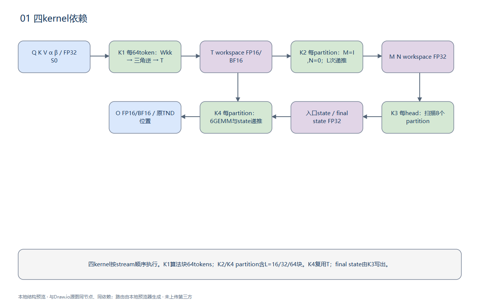
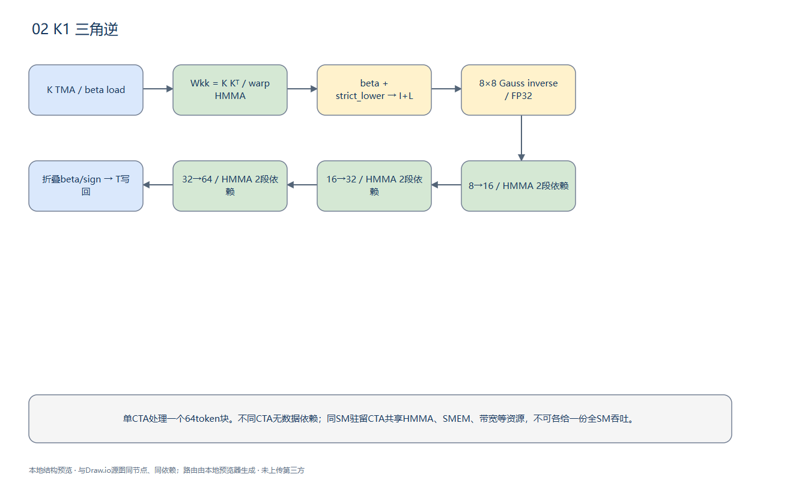
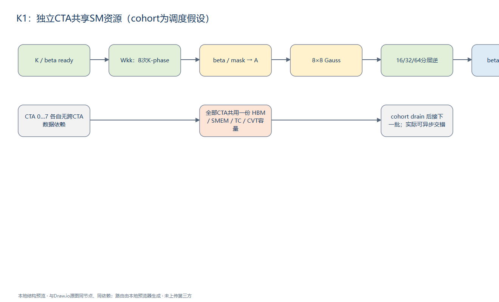
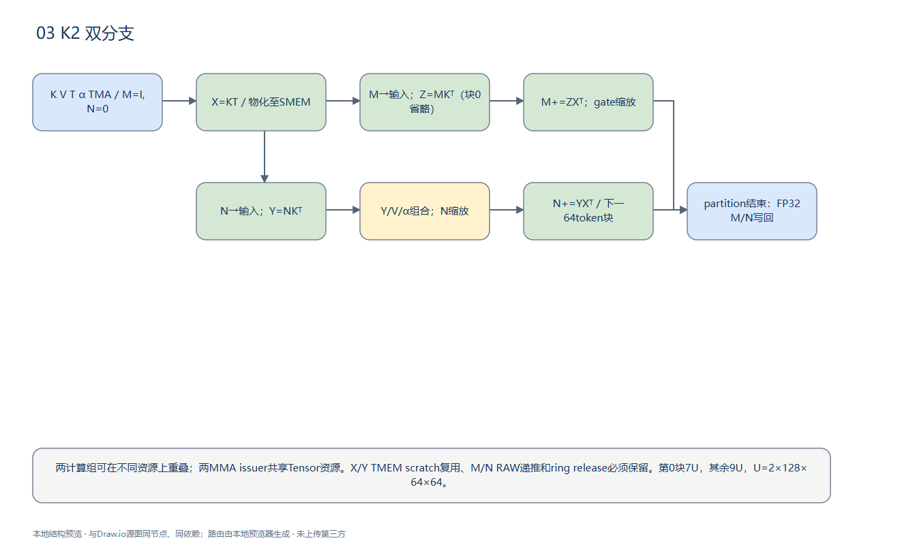
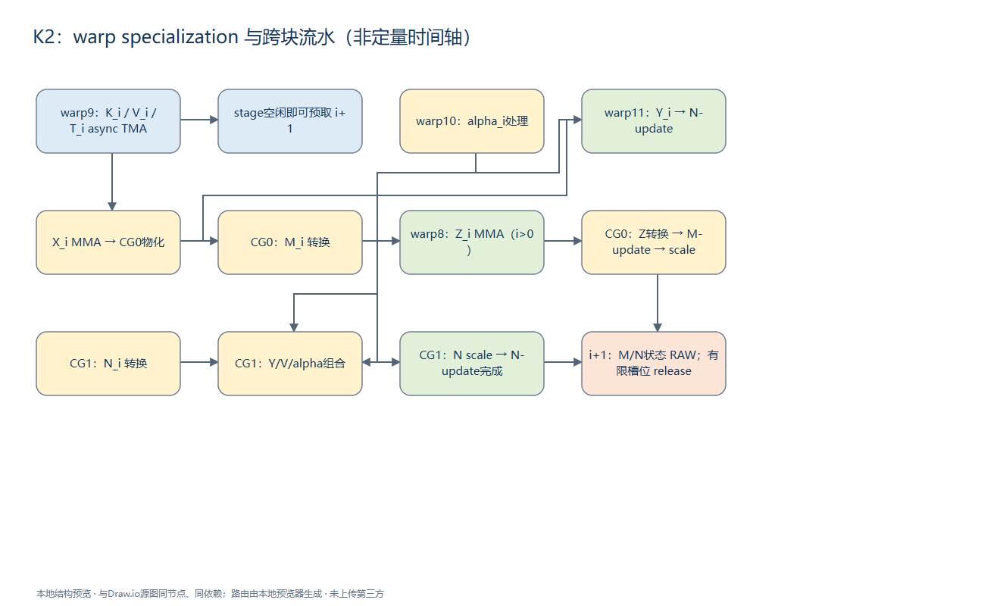
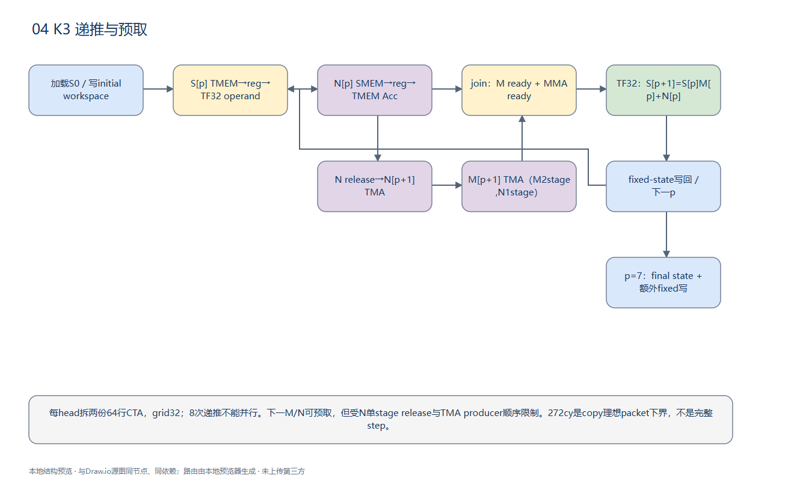
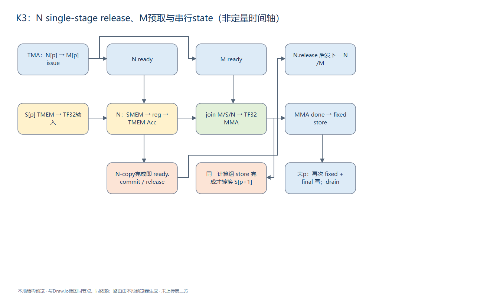
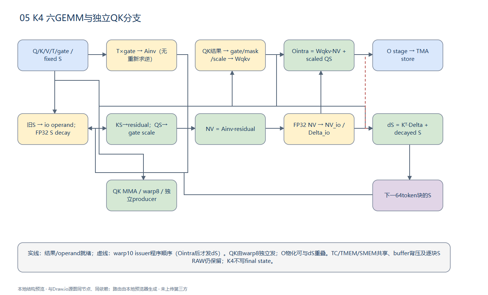
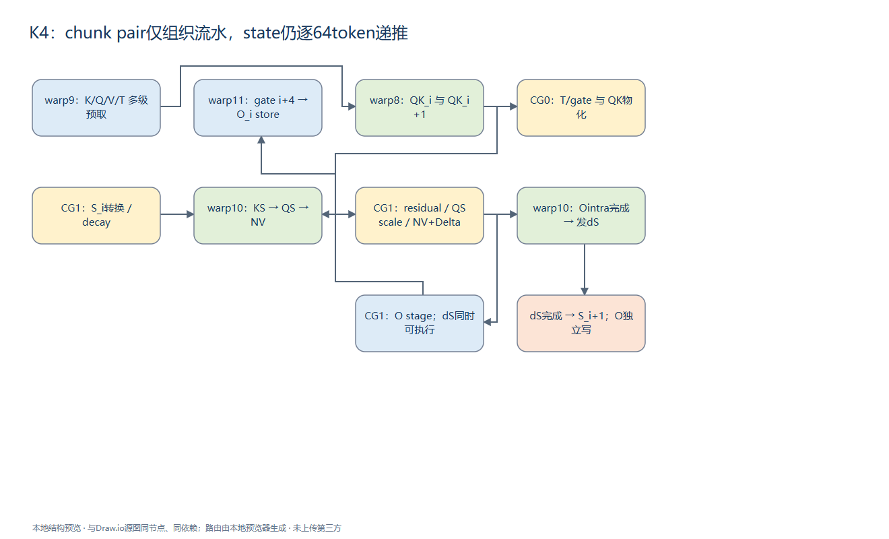

# op12：B200 GDN CP四kernel源驱动cycle模型

版本：2026-09-27；模型ID：B200_148SM_SOURCE_A_20260927。已完成源码复核；独立数值复算、冻结记录与事后Event检查见第8节。

## 1. 范围与结论口径

只分析FlashInfer原版commit `e77a4a0d276367895c3b50a642fd8f326c03fb72`。Q/K/V/O/T为FP16或BF16，alpha/beta、M/N、initial/fixed/final state为FP32；initial/final state启用，不含checkpoint、state pool、FP8实验或外部Q/K归一化耗时。数学shape以BHSD描述，实际公共输入为packed TND；B=1时两者token/head工作量相同，没有执行全局转置。

| S | CP partition C | 64token块数L | partition/head P | K1 grid | K2 grid | K3 grid | K4 grid |
|---:|---:|---:|---:|---:|---:|---:|---:|
|8192|1024|16|8|2048|128|32|128|
|16384|2048|32|8|4096|128|32|128|
|32768|4096|64|8|8192|128|32|128|

本轮给出的是“源码依赖 + 明示硬件假设”下的整数理想服务调度。源码能确定shape、循环、字节、依赖及缓冲复用；不能单独确定TMA/MMA响应、barrier、SFU、缓存和硬件仲裁的精确周期。因此不能把数值场景称为唯一准确的硬件预测，也不能因接近实测就称差距已经解释。所有未知项保留符号；数值部分令额外未知尾部为0，只用于展示模型。

## 2. 四kernel全局依赖

图为通过Draw.io MCP建立的源图的离线结构预览；源文件 `OP12_SOURCE_CYCLE_DAGS_20260927.drawio` 保留全部页。预览路由由本地生成，未上传第三方，不冒充Draw.io官方PNG导出。

1. K1对每个64token/head生成T。
2. K2对每个CP partition从M=I、N=0开始扫描L个算法块，生成仿射摘要M/N。
3. K3对每个head扫描8个partition，依次计算正确边界state；最后state由K3写出。
4. K4使用T和正确入口state，在128个partition/head工作单元上并行计算O；partition内部仍存在64token state递推。

同一CUDA stream中的四阶段串行，不能将四个kernel的resource下界取max后当作总下界。完整路径是

`C_CP = C_K1 + C_K2 + C_K3 + C_K4 + C_launch/gap/workspace_control`。

公共调度与final-state归属见[固定源码gdn_cp_prefill.py L1070–1124](https://github.com/flashinfer-ai/flashinfer/blob/e77a4a0d276367895c3b50a642fd8f326c03fb72/flashinfer/gdn_kernels/blackwell/gdn_cp_prefill.py#L1070)。K3的fixed[p]是partition p结束后的state；K4的partition0读取initial workspace，partition p>0读取fixed[p−1]，不是读取fixed[p]。

## 3. 统一硬件、单位与重叠规则

### 3.1 参数分类

| 参数 | 数值/单位 | 分类 | 解释 |
|---|---:|---|---|
|启用SM|148 SM/GPU|SOURCE FACT /设备元数据|本机设备，不从型号名称推断|
|参考SM频率|1.965 GHz|SOURCE FACT /设备快照|不是每轮锁定频率|
|dense FP16/BF16峰值|2.25 PFLOP/s/GPU|OFFICIAL HARDWARE FACT|NVIDIA HGX B200，4.5P sparse除2|
|dense TF32峰值|1.1 PFLOP/s/GPU|OFFICIAL HARDWARE FACT|2.2P sparse除2；公布值有舍入|
|HBM峰值|7.7 TB/s/GPU|OFFICIAL HARDWARE FACT|不将旧8TB/s当作本版主口径|
|SMEM服务|128 B/(SM cycle)|MODELING ASSUMPTION|全SM共享，不是CG0/CG1各独占一份|
|显式TMEM copy服务|512 B/(SM cycle)|MODELING ASSUMPTION|读/写共享总容量；不重复计MMA内部访问|
|转换服务|64 scalar elements/(SM cycle)|MODELING ASSUMPTION|不是64条warp指令；pack转换另受issue约束|
|SIMT服务|128 arithmetic results/(SM cycle)|MODELING ASSUMPTION|一FMA一个结果、两FLOP；SFU/shuffle另列|
|warp HMMA有效率rho|1（主场景）|MODELING ASSUMPTION|未证明等于tcgen05 peak|
|M64有效率eta|1；另列0.5敏感性|MODELING ASSUMPTION|half-datapath语义不能证明精确效率0.5|

硬件官方口径见[NVIDIA Blackwell datasheet p8](https://dam-cdn.nvd.orangelogic.com/AssetLink/y441155802qub41q118b2852i557jem5.pdf)、[Blackwell tuning guide](https://docs.nvidia.com/cuda/archive/12.9.1/blackwell-tuning-guide/index.html#occupancy)及[PTX tcgen05](https://docs.nvidia.com/cuda/parallel-thread-execution/#tcgen05-mma-instructions)。每SM64K个32位寄存器、228KiB共享内存，每CTA最多227KiB；驻留还要考虑实际分配粒度、TMEM和launch限制。

峰值归一化为参考cycle：

`R16 = 2.25e15/(148×1.965e9) = 7736.744377965752 FLOP/(SM cycle)`；

`RTF32 = 1.1e15/(148×1.965e9) = 3782.408362561034 FLOP/(SM cycle)`；

`B_GPU = 7.7e12/1.965e9 = 3918.575063613232 B/(GPU cycle)`。

这些是归一化模型速率，不是由商业规格证明的独立架构每周期指令吞吐。主场景分配每活跃SM `B_GPU/148=26.476858537927 B/cycle`；这是配额假设，不是“只用32SM所以HBM一定只有32/148”的事实。敏感性另给B_GPU/32或B_GPU/128，不调整参数去匹配实测。

### 3.2 周期与调度

- 单资源服务：`service_v=ceil(demand_v/rate_v)`；FLOP、bytes、elements、results严格分开。
- 依赖串行：C1+C2；仅当无数据依赖、程序顺序/复用约束允许且资源不同才可以重叠。
- join：`start_v=max(all predecessor ready, previous job on same resource finished)`。
- 同资源并行分支必须共享容量，不能分别给两份SMEM/TMEM/TC峰值后取max。
- TMA G2S保守packet：HBM服务→SMEM写；S2G：SMEM读→HBM写。物理硬件可能流式重叠，本版保守完成顺序不假装是硬件精确实现。
- 常规pipeline可写W+(N−1)I+D，但W/I/D必须来自展开DAG。先展开16/32/64块，再检查稳定区间；不能从总工作量或实测回归一个I冒充源码critical path。
- 响应延迟与服务占用不同。额外MMA/TMA/SMEM/TMEM响应、issue、barrier、fence、SFU/shuffle、alloc/free等记作tau，域为[0,+∞)，没有凭空设定的有限范围。

本数值日历未实例化完整指令frontend：`ISSUE=4`只用于K1 shuffle dispatch proxy，不是已经逐指令覆盖所有FMA/CVT/ld/st的全局issue模型。一般`T_issue≥ceil(I_all/R_issue)`仍保留符号；Gauss已知42条动态warp FMA与42条shuffle，但active-lane结果数不能替代warp指令数。K4 gate用opaque源序helper及复合scan/SFU/issue尾部，3cy只是354个普通结果的容量服务，不是整段scan真实执行周期。所有这些限制使主数值不能被宣传为已完整解释硬件时延。

换算：`us=cycles/f_Hz×1e6`，本版1us=1965个参考cycle。历史用1.74GHz换算的cycle必须先还原Event us，再按统一频率换算；不能直接与1.965GHz的cycle相减。

### 3.3 无计时静态编译

从干净固定clone导入，用KeepPTX/KeepCUBIN/KeepSASS保存原版FP16 CP产物；没有CUDA Event或NCU目标时延采集。元数据和SHA见 `static_artifacts/manifest.json`、`resource_usage.json`、`sass_audit.json`。

|kernel|threads|静态REG/thread|STACK B|static SHARED B|驻留口径|
|---|---:|---:|---:|---:|---|
|K1|128|64|0|1024|驱动无计时查询、动态SMEM24960B：容量8 CTA/SM|
|K2|384|168|0|1024|寄存器限制1 CTA/SM|
|K3|256|120|16|1024|M2stage+N1stage payload163840B，SMEM限制1 CTA/SM|
|K4|384|168|16|1024|寄存器限制1 CTA/SM|

static SHARED不包括动态SMEM。STACK=16不能简单等同于寄存器spill；LOCAL=0也不能证明没有stack访问。本次仅对FP16专门化做静态SASS验证，BF16指令dtype行为依源码，不伪称已经单独编译检查。

`static_artifacts/occupancy.json`保存Driver API无launch、无计时查询。K1使用精确动态SMEM；K2/K4用0动态SMEM得到的上限已是1，增加实际SMEM不能提高上限；K3使用最小payload也得到1。这确认容量上限，不证明运行时一定采用均匀SM分配或同步cohort。

## 4. K1：T precompute

源码入口是SM100薄子类，主体继承 `CPDeltaRuleTPrecomputeSm120`；不要因文件名sm120就误判本机执行SM120 kernel。主体见[delta_rule_dsl/delta_rule_cp_sm120.py L80](https://github.com/flashinfer-ai/flashinfer/blob/e77a4a0d276367895c3b50a642fd8f326c03fb72/flashinfer/gdn_kernels/delta_rule_dsl/delta_rule_cp_sm120.py#L80)，逆见[delta_rule_dsl/collective_inverse_hmma.py](https://github.com/flashinfer-ai/flashinfer/blob/e77a4a0d276367895c3b50a642fd8f326c03fb72/flashinfer/gdn_kernels/delta_rule_dsl/collective_inverse_hmma.py)。

一个CTA对应一个head的64token块，4warps/128threads。warp1生产K TMA，warp2加载beta；随后四warp共同计算Wkk与分层逆。计算顺序：

`K/beta ready → Wkk → beta加权/strict_lower → 逆输入SMEM → 8×8 Gauss → 8→16 →16→32 →32→64 → beta/sign折叠 → T GMEM`。

|步骤|shape / 工作量|精度 / 指令与搬运|不可省略的依赖|
|---|---|---|---|
|K/beta|K64×128=16384B；beta64×FP32=256B|K TMA→SMEM；beta普通加载→SMEM|Wkk等两者ready|
|Wkk|64×64×128，1048576FLOP|warp HMMA、FP32累加；显式K双operand读32768B|8个Kphase的acc RAW；每phase加载后才能HMMA|
|beta/mask与逆输入|2016个严格下三角乘；4096个转换；8192B写|FP32控制，逆输入FP16|mask/加权后才能写逆输入|
|8×8 Gauss|8个块；448有效FMA=896FLOP|FP32寄存器+shuffle；各src_row依赖前面的更新|不同8×8块可并行；src_row不能乱并行|
|8→16|4次，每次两个16×8×8 MMA；16384FLOP|FP16 HMMA；有stride0广播导致重复执行的M16片|第二乘依赖第一乘的转换结果|
|16→32|2次、合计32768FLOP|FP16 HMMA|两乘串行，中间转换|
|32→64|合计131072FLOP|FP16 HMMA；跨warp partial SMEM写/读/加/写|两个乘及两个crosswarp barrier|
|T输出|64×64×2=8192B|逆读、beta/sign折叠、转换、普通GMEM写|等最终逆与CTA barrier|

每CTA实际HMMA工作=1048576+180224=1228800FLOP；不是只统计数学上唯一的下三角结果。动态warp HMMA等价数为296个16816加8个1688；静态SASS为76个16816站点及2个1688站点，因warp predicate/循环不同，不能直接拿静态站点数乘4。

SMEM source-reference需求116864B/CTA；beta只有64个独立值，广播/寄存器复用会改变物理服务量。复用敏感性需求92928B不能冒充已确认交易字节。K1的bulk GMEM是24832B/CTA；计cu_seqlens两个int32 payload后模型为24840B，仍不代表实际DRAM字节。

### 4.1 多CTA调度

单CTA源序服务拆分如下。Gauss已按7个src_row逐轮展开，21组shuffle/FMA RAW不能先汇总全部算术、再汇总全部shuffle：

|串行stage|内部计算/搬运|单CTA service cy|模型资源/重叠规则|
|---|---|---:|---|
|metadata|两个int32序列边界|1|HBM packet；小访问仍计ceil|
|K/beta输入|HBM→SMEM，beta普通读|759|共享HBM；K/beta可按源producer重叠|
|Wkk|8个Kphase加载/HMMA|392|每phase operand读后MMA；acc RAW|
|beta/mask|2016乘及source-lane beta读取|63|element-loop理想资源max，响应留符号|
|逆输入物化|4096转换+8192B SMEM写|128|两服务源序串行|
|8×8 Gauss|读→转换→7轮neg/shuffle/FMA→转换→写|81|53子步；predicated warp issue未全部定价|
|8→16|四个逆合并|40|两乘及中间转换不能并行|
|16→32|两个逆合并|58|保留中间输入物化|
|32→64|跨warp合并|218|两乘与partial shared交接；barrier响应留符号|
|T输出|逆读→beta/sign/转换→GMEM|502|输出等逆完成，显式store保留|
|合计|一个CTA在理想共享资源上的服务计划|2242|不是独立硬件实测CTA latency|

K1源SharedStorage动态24960B；寄存器与共享内存共同允许的上限为8 CTA/SM。三个grid均匀分配后最忙SM分别处理q=14/28/56个CTA。主场景用同步cohort调度：每batch最多8CTA，聚合同阶段需求，共享一套SM吞吐。源码顺序子步相加；仅独立资源子步取max。

`C_K1=max(floor(q/8)×C_batch(8)+C_batch(q mod 8), ceil(grid×24840/B_GPU))`。

cohort是明示调度假设，不是SM真实最佳交错调度。不能用CTA cycle乘全grid，也不能用CTA独享全SM峰值再乘grid/8波。资源下界、cohort计划和硬件未知尾部必须分别报告。

`C_batch(k=1…8)={2242,4426,6643,8830,11049,13238,15456,17641}`。最忙SM的CTA数由ceil(grid/148)给出，不是一个head的8个CP partition在同SM绑定；K1调度单位本来是64token块。S8192为8+6CTA，S16384为8+8+8+4，S32768为7组8CTA，分别得到30879/61753/123487cy。同步cohort可能比真实交错调度更保守，但多CTA共享容量不会变成8倍峰值。

## 5. K2：M/N precompute

主体见[gated_delta_net_cp.py L22](https://github.com/flashinfer-ai/flashinfer/blob/e77a4a0d276367895c3b50a642fd8f326c03fb72/flashinfer/gdn_kernels/blackwell/gated_delta_net_cp.py#L22)。每CTA一个head/partition，M/N均为128×128 FP32。摘要表达为 `Sout=Sin·M+N`；实际operand view含转置，不能由workspace物理shape误推乘法方向。

|warp|源码职责|
|---|---|
|0–3 CG0|M初始化；X物化；后续块M/Z转换；M更新后缩放；M写回|
|4–7 CG1|N初始化/转换；读取Y/V/alpha并组合；N缩放；N写回|
|8|transfer MMA issuer，Z与M-update|
|9|K/V/T TMA producer|
|10|alpha producer与累计门控|
|11|state MMA issuer，X、Y、N-update|

K/V/T stage=3/3/3，alpha=4，X=2；TMEM512列。M=I与N=0各写64KiB，共享TMEM总128KiB，不能按两个独立512B/cy通道算128cy；主服务下界为256cy。

定义U=2×128×64×64=1048576FLOP：

|MMA|实际shape|每次FLOP|次数|
|---|---|---:|---:|
|X=KT|128×64×64|U|L|
|Y=NKᵀ|128×64×128|2U|L；N0=0也执行|
|M update|128×128×64|2U|L；块0用K代Z但仍执行MMA|
|N update|128×128×64|2U|L|
|Z=MKᵀ|128×64×128|2U|L−1|

第0块7U，其余块9U，总 `(9L−2)U`。Z转M-update输入是TMEM读/转换/布局工作，不是额外U的MMA。

精确分支链：

`X MMA → FP32 TMEM读32KiB → 8192元素转换 → SMEM写16KiB → X ready`；

`M旧值 → io operand → Z MMA → Z转换 → M-update(accumulate=True) → FP32 gamma缩放M`；

`N旧值 → io operand → Y MMA → gamma·Y+V·coef → io Y输入；FP32 gamma缩放N → N-update(accumulate=True)`。

`gamma·Y+V·coef`若lower为mul+FFMA，对每个8192元素是2个算术结果、3FLOP；V io→FP32及结果FP32→io转换都要计。不能把3FLOP当3个scalar-result服务。

CG0/CG1可以重叠独立copy/epilogue，但两个issuer共享同一TC服务资源。X/Y复用同一TMEM scratch；X消费完才能由Y覆盖。M/N的下一块输入都依赖前一块更新完成。stage数量只提供有限预取，不解除递推。

每CTA bulk GMEM `41216L+131072 B`：每块K16KiB+V16KiB+T8KiB+alpha256B，末尾M/N各64KiB输出。alpha的三通道生成、消费侧共享读取、广播与SFU单列，不将256B输入错误当作全alpha SMEM流量。

grid128在148SM、1CTA/SM的均衡主场景一波结束，kernel周期是最慢CTA的完成周期，不乘128。warmup包含初始化和首块准备；steady包含双分支join与共享资源仲裁；drain包含M/N最后store及done handoff。短L的数值直接展开DAG，不用仅FLOP/peak。

每个wait/commit/release保留为因果节点，额外响应周期留符号。CG0下一块X物化在前块M scale之后；m_coeff读在本块X及可选Z转换之后。CG1完成N转换、等待Y之后才读n_coeff和执行processY；不能把V/alpha读取提前成独立生产者。alpha producer是单warp同步循环，本块处理/commit完成后才处理下一块。M/N最后输出可独立执行，done是最终join，不是N store的前置依赖。

X/Z/processY的128×64路径按两个寄存器subtile展开，M/N的128×128路径按四个subtile展开。每sub保留读→转换/运算→写→下一sub的源顺序；跨helper或其他warp的并行仍必须共享SMEM/TMEM/CVT容量。布局推导的tile数与无计时编译证据分开注明，不虚构已实测流水响应。

### 5.1 单helper服务、循环与首尾开销

以下是helper独占资源、无其他warp竞争时的packet服务，不等于该helper在完整图中的wall cycle：

|helper|subtile与源顺序|独占service cy|数据/运算|
|---|---|---:|---|
|X物化|2×(TMEM读32 + CVT64 + SMEM写64)|320|2个64×64 FP32→io；全矩阵32KiB读、16KiB写|
|M/N operand转换|4×(TMEM读32 + CVT64 + TMEM写16)|448/矩阵|4个128×32 subtile；FP32读64KiB→io写32KiB|
|Z转换|2×(TMEM读32 + CVT64 + TMEM写16)|224|两个64×64 subtile|
|processY|2×[32+64+max(64,128)+64+64+16]|736|Y读、V读、V转换/alpha读、mul+FMA、输出转换、TMEM写|
|M或N缩放|4×(TMEM读32 + SIMT32 + TMEM写32)|384/矩阵|FP32读/写各64KiB；16384乘|
|M或N末尾store|4×(TMEM读32 + HBM619)|2604/矩阵|FP32写64KiB；两分支共享HBM，不可各独占峰值|

processY的V转换与alpha读取按不同资源的packet取max，是明确的乐观组内重叠假设；同warp实际issue限制仍在未知项内。X若采用整helper资源池max会算出128cy物化，但不能把它当作此completion-serial subtile图的320cy，更不能漏掉TMEM读/CVT。

alpha逐块有482个普通结果服务：64 epsilon加、290 scan/carry加、64 end-log减、64取负；传统加/减FLOP为418，取负单列。64log2、128exp2和12次warp shuffle有严格源顺序，响应/issue/SFU服务未公开，本版保留符号，不能将普通结果计数当作整段门控实际周期。

完整日历第一次N-update完成7039cy；第1块间距2324cy；内部块间距2314cy；末两块间距2324cy；最后M/N输出join drain为4840cy。因此三种L的源图压缩式为：

`C_K2(L)=7039+2324+(L−4)×2314+2×2324+4840=9595+2314L`。

L16/32/64分别46619/83643/157691cy。这是从逐节点源图中验证的首段、稳态和末段模式，不是对目标时延拟合的直线；不外推任意短L/varlen/未定义尾块。SMEM、TMEM、CVT、TC与HBM资源busy下界见工作簿Summary，不能用busy sum替代这条双分支关键路径。

## 6. K3：fixup

主体见[gated_delta_net_cp.py L1519](https://github.com/flashinfer-ai/flashinfer/blob/e77a4a0d276367895c3b50a642fd8f326c03fb72/flashinfer/gdn_kernels/blackwell/gated_delta_net_cp.py#L1519)。16个head在该dispatch阈值下选择utcmma64；每head的128行拆成两个64行CTA，因此grid=16×2=32，非32个head或partition。

256threads；warp0–3计算/转换/copy/store，warp4发TF32 MMA，warp5 TMA，warp6–7没有矩阵payload职责。源码M stage=2、N stage=1。单CTA保留FP32 Acc和TF32 operand，TMEM256列；M全矩阵64KiB被两个row CTA重复请求，N每CTA取32KiB。

初始化有initial state：读S0 32KiB→TMEM，再写initial workspace 32KiB。每partition的compute顺序：

`S[p] TMEM→reg→TF32 operand → wait N → N SMEM→reg→FP32 Acc → ready.commit → N.release → wait MMA done → fixed-state GMEM写 → done.release → 下一p`。

MMA启动需同时满足M ready和mma-ready；执行 `[64,128]×[128,128]` TF32、FP32累加，2097152FLOP/partition。M作为FP32 workspace送入TF32 operand路径，不额外凭空增加一份显式M转换kernel。p=0也执行一次MMA，因为本分析initial state启用；没有initial state的首partition跳过路径不能混入。

### 6.1 N-copy与预取

32KiB N-copy由四个8KiB sub组成。每sub理想SMEM读64cy、TMEM写16cy。completion-serial服务场景=4×(64+16)=320cy；若跨sub的SMEM与异步TMEM packet完全流式重叠，下界=64+16+3×64=272cy。272不包含wait、issue或barrier，也不等于每partition时延。

N.release在N-copy之后、MMA done等待之前，因此下一N/M可与当前MMA/store重叠。但producer顺序是N[p]然后M[p]；N只有一stage，N[p+1]的issue受前一N.release约束。M两stage不能让M0/M1在启动时任意提前填满。

compute group在fixed store后才进行下一S转换；同一warp组的转换、N-copy、store不能相互任意取max。last p=7完成普通fixed写后，`store_acc(store_output=True)`再次写fixed[7]并写final state；不是取代前一次fixed写。

每CTA 8次MMA=16777216FLOP；GMEM payload请求1179648B，explicit TMEM copy1146880B，explicit SMEM/TMA1048576B，转换65536元素。全kernel TF32工作536870912FLOP、请求37748736B；其中M存在row CTA重复请求。去重M地址后29360128B也不等于真实DRAM流量。

三组shape均P8，因此K3的源码图、grid、工作和条件周期相同。变化只能来自缓存/上下文、频率、调度或未定硬件行为，不来自L16→32→64。

### 6.2 周期展开与首末partition

|串行阶段|资源与数量/CTA|单次理想服务cy|依赖/重叠|
|---|---|---:|---|
|initial读与initial workspace写|各32768B GMEM；TMEM各32768B|packet各4×(310+16)=1304|p0之前；与producer争用HBM|
|N TMA|32768B HBM→SMEM|1238+256=1494|N1stage，release后才能用下一槽|
|M TMA|65536B HBM→SMEM|2476+512=2988|M2stage，issue受producer顺序约束|
|S转换|4×[TMEM8192B读+2048CVT+TMEM8192B写]|4×(16+32+16)=256|前一fixed store后进行下一转换|
|N→Acc|4×[SMEM8192B读+TMEM8192B写]|320；流式敏感性272|copy done后ready.commit/N.release，不必等MMA done|
|TF32 MMA|2×64×128×128 FLOP|555；eta0.5时1110|join(M ready,S input,N Acc)|
|每p fixed写|32768B TMEM→reg→GMEM|4×(16+310)=1304|wait MMA done后；下一转换依赖此helper|
|最后附加写|fixed[7]、final各32768B；TMEM读取一次|4×(16+310+310)=2544|不替代普通fixed[7]写|

服务值不是整个partition周期：它们会与producer互相遮盖，也会争用共同资源。主日历initial workspace完成6290cy；p0…p6 fixed完成间距5562cy；p7尾部间距2435cy；附加drain2544cy。因此：

`C_K3(P=8)=6290+7×5562+2435+2544=50203cy`。

32CTA一波时kernel span与单CTA日历相同，不乘32。若HBM配额从1/148改为1/32，主图重算15371cy；这说明“约5万cy”即便接近实测，也不能反过来验证带宽配额假设。更不能用8次MMA的4440cy资源服务代替完整partition链。

## 7. K4：final prefill

主体见[gated_delta_net_cp_prefill.py](https://github.com/flashinfer-ai/flashinfer/blob/e77a4a0d276367895c3b50a642fd8f326c03fb72/flashinfer/gdn_kernels/blackwell/gated_delta_net_cp_prefill.py)。每CTA一个partition/head，384threads；TMEM512列。128CTA在一CTA/SM场景覆盖128/148=86.49%的SM，不能把CTA时间乘128。

|warp|职责|
|---|---|
|0–3 CG0|预计算T加门控生成Ainv；QK门控/mask/scale并物化|
|4–7 CG1|state加载/转换/decay；KS residual；QS缩放；NV/Delta物化；O stage|
|8|QK MMA issuer，chunk pair仅为流水组织，非一个M128融合QK|
|9|按K→Q→V→T发TMA|
|10|按KS→QS→NV→Ointra→dS发MMA|
|11|gate累计与O TMA store；先四块gate预取，循环中gate i+4在O i store之前|

stage：Q2/K3/V3/T2/Ainv3/QK2/gate5/O2。TMEM：[0,128) FP32 S；[128,192) QS/O；[256,384)双QK槽；[384,448) KS/NV共享；[448,512) state/residual/NV/Delta输入视图复用。有限槽位及两消费者Q/K release必须保留，不是所有GEMM均能无界并发。

|MMA|shape M×N×K|FLOP/块|指令|
|---|---|---:|---|
|QK|64×64×128|U|FP16/BF16 tcgen05；M64效率另作敏感性|
|KS|128×64×128|2U|tcgen05、FP32累加|
|QS|128×64×128|2U|同上|
|NV|128×64×64|U|同上|
|Ointra|128×64×64|U|直接累加在已缩放QS accumulator上|
|dS|128×128×64|2U|直接累加在decayed FP32 S上|

每64token块合计9U=9437184FLOP，36个source atom-work等价单元；不计算Wkk，也不再次求三角逆。K1的T仍需按当前gate变换，但这不是重新执行inverse。

源执行精度细节：state先取旧FP32值并转换到io operand，然后再decay FP32 state；KS在FP32乘gate后先round到io，再做V_io−KS_io的io减法。本次FP16 PTX/SASS确认packed half subtraction，因此不能把原版residual描述成完全FP32且可任意融合FMA。Delta从FP32 NV fragment生成，再分别round NV/Delta。

允许的重叠：state operand发布后KS/QS可与state decay/gate展开重叠；QS可与residual、NV可与QS scale、dS可与O stage重叠。必须保留issuer顺序、TC共享服务、单槽KS/NV及QS/O复用、state RAW、Q/K双消费者、gate5stage、O2stage与store wait_group0。

每CTA bulk请求 `65536+73984L B`：一次64KiB initial/fixed state；每块Q/K/V各16KiB、T8KiB、alpha256B、O16KiB。公共路径不读beta、不写final state、不把NV/Delta搬至GMEM。未使用的末尾source state read在捕获的干净SASS中被DCE，主图不计此64KiB读。

explicit TMEM copy为393216B/块，source conversion为61440元素/块；ordinary arithmetic为74146个FP32结果+8192个io residual减法结果。gate source lane-reference字节可经shared广播/CSE缩减；本版同时保留source-request与明确假设的复用场景，SFU/shuffle/issue仍留符号。

### 7.1 节点服务与依赖

|计算/搬运|单块工作|理想TC服务cy|必须串行的join / 可重叠|
|---|---|---:|---|
|fixed S读|65536B/CTA一次|—|读→TMEM publish；和Q/K/V/T/gate争HBM|
|QK|U FLOP|136|Q/K ready；与state分支可ready并行，仍共享TC|
|T/gate→Ainv、QK epilogue|FP32 gate/scale、io转换/SMEM物化|—|各自ready后才能join；不重复inverse|
|KS|2U|272|旧S io+K；可与FP32 state decay并行|
|QS|2U|272|旧S io+Q；issuer在KS之后|
|residual|KS×gate→io，再V_io−KS_io|—|等KS；可与QS MMA重叠|
|NV|U|136|residual及Ainv ready；与QS scale可重叠|
|NV/Delta输入|FP32 NV分别形成NV_io、Delta_io|—|helper全部完成才发布，不按sub提前消费|
|Ointra|U|136|QK_io、NV_io、scaled QS Acc ready|
|dS|2U|272|Delta与decayed S Acc ready；可与O stage重叠|
|O store|每块16384B SMEM读→GMEM写|—|O2stage、wait/release；warp11先gate i+4|
|下一S|dS后的state|—|RAW不能与当前dS任意取max|

每块TC服务总1224cy只是共享资源容量，完整块cycle来自图。按最后O store完成定义，block0 first O完成11663cy；第一chunk pair完成14721cy；第二pair增加6190；内部pair增加6184；倒数第二/最后pair为5801/6112cy。对L16/32/64：

`C_K4(L)=14721+6190+(L/2−4)×6184+5801+6112=8088+(L/2)×6184`。

cycle分别57560/107032/205976；该有限场景公式不外推任意tail/短序列。pair区间不意味着block0和block1独立：state逐block递推、双QK流水和边界释放仍在展开图中。first/last单block时戳见`k4_calendar_L*.json`的blocks字段；所有时戳是模型值，不是目标kernel实测拆分。

## 8. 数值汇总、审查与实测检查

### 8.1 最终源模型数值

下表均为上述主假设下的整数资源服务日历，未知响应、完整issue、barrier/SFU/cache、launch/gap未定价。不是无条件的物理时延下界。

|S|K1 T|K2 M/N|K3 fixup|K4 final|四stage合计 cy|合计μs@1.965GHz|
|---:|---:|---:|---:|---:|---:|---:|
|8192|30879|46619|50203|57560|185261|94.280|
|16384|61753|83643|50203|107032|302631|154.011|
|32768|123487|157691|50203|205976|537357|273.464|

|kernel|单CTA / 最忙SM|resident CTA/SM|grid / 连续waves|kernel换算|
|---|---|---:|---|---|
|K1|单CTA2242cy；最忙SM q14/28/56|8容量|grid2048/4096/8192；grid/(148×8)=1.730/3.459/6.919|共享cohort按2/4/7个batch，而非复制吞吐|
|K2|46619/83643/157691cy|1|grid128；0.865wave；主场景1批|单CTAspan，不乘128|
|K3|P8：50203cy|1|grid32；0.216wave；主场景1批|单CTAspan，不乘32|
|K4|57560/107032/205976cy|1|grid128；0.865wave；主场景1批|单CTAspan，不乘128|

FLOP控制总数保持：CP四kernel合计41.439723520/82.611011584/164.953587712GFLOP。K2、K4和K1逆的实际重复执行均计入源码工作，而不是最低数学必要工作口径。细分GMEM请求与metadata见Work and Traffic及完整DAG，不能将逻辑请求当NCU DRAM字节。

### 8.2 容量上限与依赖路径的差别

|S|K2最大资源busy cy|K2 DAG/busy|K3最大资源busy cy|K3 DAG/busy|K4最大资源busy cy|K4 DAG/busy|
|---:|---:|---:|---:|---:|---:|---:|
|8192|29881|1.560|44592|1.126|47212|1.219|
|16384|54809|1.526|44592|1.126|91948|1.164|
|32768|104665|1.507|44592|1.126|181420|1.135|

这里的busy是各packet `ceil(demand/rate)`之和，DAG还包含依赖、buffer reuse和源角色phase约束。它说明资源roofline遗漏哪些时间结构，不是由实测拆出“依赖耗时”。本主场景最大busy恰为HBM配额服务，但不能据此判定真实kernel memory-bound：这是采用每SM1/148带宽、全请求HBM的结果。

严谨的无缓存条件容量下界另用全GPU7.7TB/s；某种list日历只是合法条件计划，不必是最短计划。K2添加保守packet完成顺序后可能改变仲裁而反而缩短L16span；报告保留45587/84435/162131cy该替代场景，不将它标为单调上下界。固定resource-order的Excel修改rate则不重新寻找最佳仲裁。

### 8.3 主要结构瓶颈与待证事项

|kernel|源码确定的限制|本模型揭示的结构|尚不能直接确认的真实第一瓶颈|
|---|---|---|---|
|K1|7轮Gauss RAW、分层逆两乘、shared交接；多CTA共享资源|小HMMA与SIMT/物化串行，cohort共享SMEM/issue|真实CTA交错、HMMA issue/依赖响应、predicated warp吞吐|
|K2|X/Y alias、M/N递推、同warp转换/scale顺序、双issuer共用TC|资源池max不足以替代helper subtiles及双branch join|MMA响应、同步、copy-layout实际指令、alpha SFU、缓存与TMA等待|
|K3|8partition串行state；N1stage release控制下一N/M预取；fixed store后才convert|M/N producer和compute handoff可能决定间隔；grid32|M/N workspace约16MiB、fixed约8MiB可进入本机约126MB L2，全HBM假设未验证；近实测不验证该假设|
|K4|逐块dS RAW、KS/QS/NV/O/dS issuer顺序、TMEM alias、gate/O同producer|chunk pair只重叠独立QK/搬运，无法消除state链|copy/convert实际吞吐、MMA完成响应、gate SFU、stage handoff及host/device launch间隙|

需要微基准或纯净消融才能将这些“结构候选”升级为已量化的硬件瓶颈；不能为了补齐残差加一个经验cycle/块。K2/K4相同grid128，增加S只增加每CTA迭代长度，不增加SM覆盖。

### 8.4 未知项与敏感性

|项|主设定与分类|未知/替代场景|影响与结论边界|
|---|---|---|---|
|HBM配额|B_GPU/148，MODELING ASSUMPTION|K3改/32：15371cy；K4 L16改/128：56032cy|SM覆盖率不能证明HBM可用容量按比例下降|
|M64 TC效率|eta=1，MODELING ASSUMPTION|K3 eta0.5：50757cy；K4 L16仅QK eta0.5：58453cy|half-datapath不等于已测准确0.5|
|HMMA吞吐|rho=1，MODELING ASSUMPTION|rho须独立吞吐测量|公布tcgen05等效峰值不能给准确warp HMMA issue间隔|
|SMEM/TMEM/CVT/SIMT|128B/512B/64elem/128result per SMcy，MODELING ASSUMPTION|bank冲突、broadcast、指令pack、eligible warp、完整issue未知|不能把active-lane结果数当完整warp指令服务|
|memory response/cache|bulk请求视作HBM，额外response=0理想场景|L1/L2命中、请求合并、SM覆盖外HBM分配、TMA并发响应未知|没有将GMEM requests误写成实测DRAM|
|barrier/commit/wait/release|保留源依赖；额外tau=0|tau范围[0,+∞)，没有虚构有限范围|0不是声明同步/issue零成本|
|SFU/scan|保留log→scan→exp的源序；普通算术显式计数|shuffle/SFU/RAW响应留符号；K4 gate opaque helper|gate3cy只是普通结果容量服务，非整scan真实耗时|
|CTA/SM调度|K1同步cohort；其余均衡单wave|真实交错、分配粒度、尾波不均衡|容量8与1确认；运行时排程仍假设|
|参考时钟|f_ref=1.965GHz设备快照|连续频率曲线未知|cycle与us换算准确，历史别频cycle不得直接相减|

### 8.5 Reviewer发现、修正与冻结

最终审查Critical=0。R1/R2/R3/R6/R7为源码phase/RAW或工作量Major，已修正；R4错误N-store依赖为Minor，已修正；R5硬件配额/响应等Major不确定性明确保留。另修正K4 S2G方向和terminal DCE，保留静态SASS站点与动态调用的区别。

- R1：不再提前CG0的X/coeff或CG1的processY读；issuer与epilogue的依赖分开。
- R2：alpha单warp下一块须等前块发布，而非无界并发。
- R3：K1 Gauss展开53子步，恢复shuffle→FMA的7轮RAW。
- R4：N output不强加M done前驱，CTA completion再join两者。
- R6：K2 helper按2/4个寄存器subtile展开，恢复read→convert→write次序。
- R7：alpha补64 epsilon加，恢复log/scan/carry/end-sub/exp/neg/publish顺序。

Numerical Sweep独立重放19个日历，所有span和工作量控制对账，零数值分歧。`SOURCE_MODEL_FREEZE.json`记录2026-09-26T20:03:19.512Z（北京时间09-27 04:03:19）的15个模型/脚本/审查SHA及5个固定源码SHA。冻结前未读取目标Event/NCU timing。本轮有共享常数与独立review；无未决critical path分歧，未创建可选Astra auditor。Lead会话模型不能在会话中自行切换，已说明；specialist按用户指定tier创建。

### 8.6 事后CUDA Event sanity check

冻结且核对所有模型hash后才读取原归档 `evidence_gap_ablation_20260920/cp_stage_same_round/trial{1,2,3}.json`。FP16、三个S/C、initial/final启用、1965MHz前后快照均匹配；取三轮trial median的median，使用Event，不使用NCU replay duration。

|S|kernel|模型μs@1.965GHz|Event μs|残差μs（Event−模型）|
|---:|---|---:|---:|---:|
|8192|K1|15.715|21.920|6.205|
|8192|K2|23.725|38.176|14.451|
|8192|K3|25.549|27.888|2.339|
|8192|K4|29.293|71.120|41.827|
|16384|K1|31.426|39.120|7.694|
|16384|K2|42.566|64.752|22.186|
|16384|K3|25.549|28.496|2.947|
|16384|K4|54.469|99.136|44.667|
|32768|K1|62.843|70.656|7.813|
|32768|K2|80.250|112.416|32.166|
|32768|K3|25.549|27.904|2.355|
|32768|K4|104.822|153.264|48.442|

独立stage是Python调用包装的2warmup/20Event，重复使用固定输入/workspace；整条CP是20warmup/100Event和Q/K/V rotating。部分stage的CV超过5%（K3约12.6–15.2%，K4最短shape最高约6.0%），不能当严格误差验证。Event窗口也可能包含host提交间隙；现有证据不足以把全部固定差值归为launch/descriptor，更不能用该差值补一个拟合常数。

三个完整路径Event分别145.104/214.704/352.080μs；独立stage median之和不替代完整路径Event。理论四stage94.280/154.011/273.464μs不含launch/gap/workspace控制，也不是相同缓存/包装条件的完整路径预测。

趋势检查支持K1/K2/K4递增、K3大致恒定。K3接近仅说明数量级相似；K2仍有14.5–32.2μs未解释，K4有41.8–48.4μs未解释。当前尚不能声称形成了接近实测且因果完整的模型。下一步应独立测量TC/copy响应与实际issue、测K3缓存和N-stage handoff、用NSYS区分wrapper/launch间隙，再以未参与建模shape验证，而不是从Event反向调整吞吐。

## 9. 证据与复现

- `hardware_model.md/json`：共同硬件口径、来源、未知项和调度规则。
- `k1_model.json`、`k2_model.json`、`k3_model.json`、`k4_model.json`：源码工作量与依赖。
- `k*_calendar*.json`：每packet/节点work、resource、前驱、仲裁前驱、service/start/end；保存所有case。
- `approved_model.json`：lead核对后冻结的统一模型，后续仅扫公式，不能用目标时延反向修改。
- `static_artifacts`：无计时原版编译与资源/SASS证据。
- `OP12_SOURCE_CYCLE_DAGS_20260927.drawio`：六页可编辑图；`figures`为离线预览。
- `OP12_SOURCE_PIPELINES_20260927.drawio`：四页流水/释放图；`pipeline_figures`为离线预览。
- `outputs/source_model_20260927/OP12_FOUR_KERNEL_SOURCE_CYCLE_MODEL_20260927.xlsx`：输入分类、工作量、四kernel明细、逐节点公式、sweep、敏感性、review。
- `numerical_sweep.py/json/md`：独立重放，所有资源工作量、CTA/grid/wave及四kernel汇总。
- `reviewer_findings.md/json`：发现、源证据、修正与最终不确定性。
- `SOURCE_MODEL_FREEZE.json`与`event_sanity_check.json`：模型先冻结、Event后读取的顺序及hash；后者不馈入理论模型。

原始上游clone保持clean；新的脚本、模型和交付物位于独立日期目录，不覆盖旧报告或旧工作簿。
